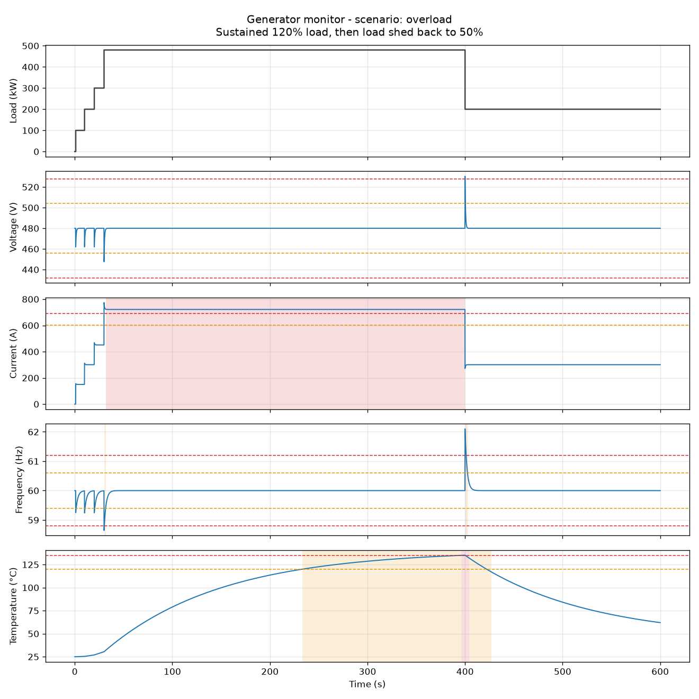

# Generator Monitoring and Alarm Dashboard

[](https://github.com/Wahid-y06/generator-monitoring-dashboard/actions/workflows/tests.yml)

A Python simulation of a 500 kVA, 480 V, 60 Hz standby generator with a
panel-style alarm system. It models how voltage, current, frequency and
winding temperature respond to load changes, and raises **warning** and
**critical** alarms using the same techniques real genset controllers use to
avoid nuisance trips: **hysteresis** and **on-delay timers**.



*Overload scenario: current goes critical within 2 s of a 120% load step,
while the winding temperature takes ~200 s to reach its warning limit. Shaded
regions show active alarms.*

## What it models

| Quantity | Behaviour |
|---|---|
| Frequency | Dips on load pickup, rises on load rejection; isochronous governor recovers it (τ = 2 s) |
| Voltage | Dips/swells on load steps; AVR recovers it (τ = 0.5 s) |
| Current | `I = P / (√3 · V · pf)`, rated current 601 A |
| Temperature | First-order thermal model; steady-state rise ∝ (I / I_rated)², because copper losses scale with I² |

All parameters (ratings, time constants, thresholds) are in
[`config/default.json`](config/default.json).

## Alarm logic

Each channel has optional warning/critical limits on the high and low sides.

- **Hysteresis:** an active alarm only clears once the value moves back past
  `limit − hysteresis`, so noise around a threshold can't make it chatter.
- **On-delay:** an alarm is only raised after the condition persists for
  `delay` seconds. The 0.75 Hz frequency dip on a 25% load step lasts ~0.45 s,
  so the 0.5 s delay filters it out, while a sustained under-frequency still trips.
- **Escalation/de-escalation:** NORMAL → WARNING → CRITICAL and back, with
  every transition time-stamped in an event log.

## Scenarios

| Scenario | What happens |
|---|---|
| `normal` | Load steps within rating; no alarms |
| `overload` | 120% load for 370 s: current critical, then temperature warning → critical; all clear after load shed |
| `load_rejection` | Breaker trip drops 95% load: over-frequency critical, over-voltage transient |
| `large_step` | 0 → 90% motor-start step: under-frequency critical that recovers in ~3 s |

## Usage

```bash
pip install -r requirements.txt

python -m genmon --list
python -m genmon --scenario overload --plot overload.png --csv overload.csv
python -m genmon --scenario normal --noise 0.001 --seed 1   # add 0.1% sensor noise
```

Example output:

```
t=    32.0s  current      RAISED   NORMAL -> CRITICAL  (value=722.58)
t=   228.3s  temperature  RAISED   NORMAL -> WARNING  (value=120.00)
t=   391.2s  temperature  RAISED   WARNING -> CRITICAL  (value=135.00)
t=   400.0s  current      CLEARED  CRITICAL -> NORMAL  (value=272.13)
```

## Tests

```bash
python -m pytest
```

34 tests cover the alarm state machine (hysteresis, on-delay, escalation,
low-side limits, config validation), the generator model (rated current,
recovery time constants, thermal steady state, time-step convergence), and
end-to-end scenarios, including a check that 0.1% sensor noise does not cause
alarm chatter.

## Project layout

```
genmon/
  model.py       generator dynamics
  alarms.py      threshold monitor with hysteresis + on-delay
  simulation.py  scenarios, config loading, simulation loop, CSV export
  plot.py        dashboard trend plot
  __main__.py    command-line interface
config/default.json
tests/
```

## Limitations

This is a simplified model for exploring alarm logic, not a machine-accurate
generator simulation: dips are modelled as instantaneous steps with
first-order recovery, and there is no governor droop, reactive-power model or
protection tripping. Protection (breaker trip) logic is the subject of a
separate project.
